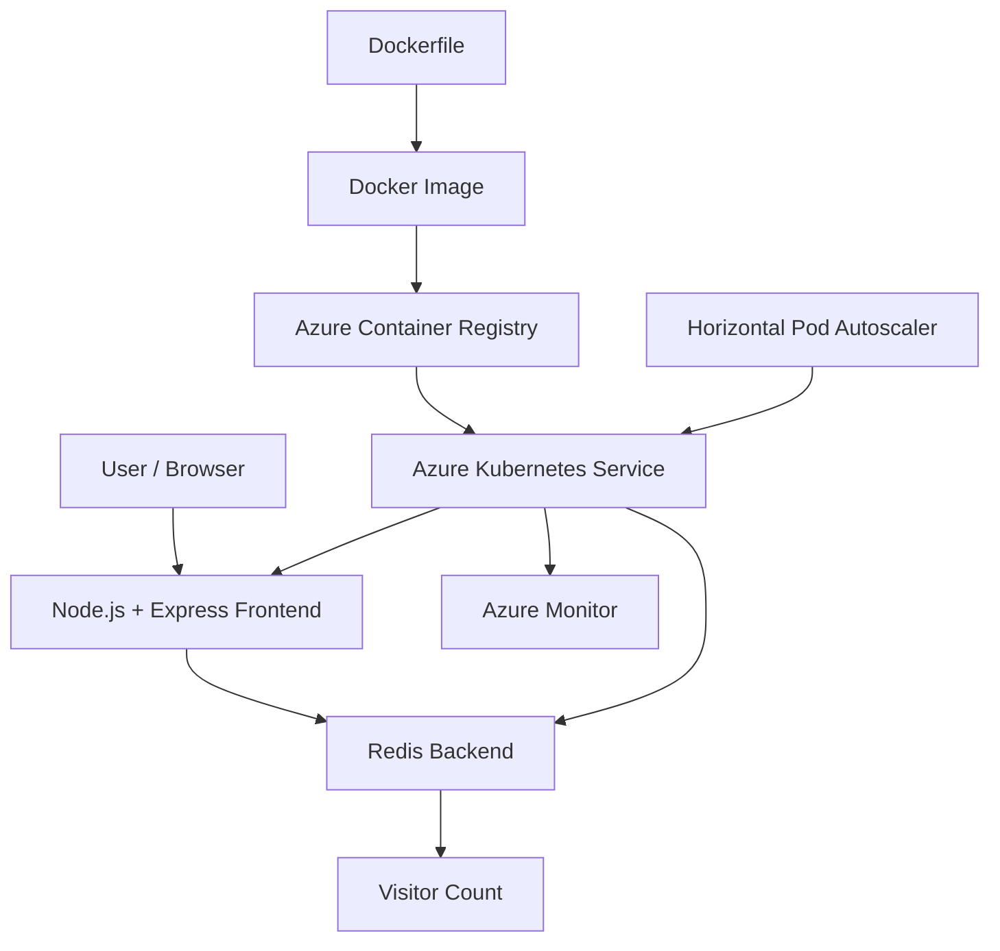

# ☁️ Cloud Visitor Counter on Azure Kubernetes Service

A containerized web application built with **Node.js, Express.js, and Redis**, deployed on **Microsoft Azure Kubernetes Service (AKS)** with automatic horizontal scaling and cloud monitoring.


---

## 📌 Table of Contents

- [Project Overview](#-project-overview)
- [Objectives](#-objectives)
- [Technology Stack](#-technology-stack)
- [System Architecture](#-system-architecture)
- [Project Structure](#-project-structure)
- [Features](#-features)
- [Run Locally](#-run-locally)
- [Docker Containerization](#-docker-containerization)
- [Azure Deployment](#-azure-deployment)
- [Kubernetes Autoscaling](#-kubernetes-autoscaling)
- [Health Checks and Metrics](#-health-checks-and-metrics)
- [Monitoring and Alerts](#-monitoring-and-alerts)
- [Testing and Results](#-testing-and-results)
- [Security Considerations](#-security-considerations)
- [Conclusion](#-conclusion)

## 📖 Project Overview

The Cloud Visitor Counter is a cloud-native web application that records and displays the number of visits to a webpage. The frontend is developed using Node.js and Express.js, while Redis serves as the backend data store for the visitor count.

The application is containerized with Docker, stored in Azure Container Registry (ACR), and deployed on Azure Kubernetes Service (AKS). Kubernetes manages the application containers, while a Horizontal Pod Autoscaler (HPA) adjusts the frontend replica count according to CPU utilization.

The project demonstrates important cloud computing concepts, including containerization, container orchestration, cloud image registries, autoscaling, health checks, and monitoring.

## 🎯 Objectives

- Develop a visitor counter using Node.js and Redis.
- Package the application using a multi-stage Dockerfile.
- Run the frontend and Redis locally using Docker Compose.
- Store and manage container images using Azure Container Registry.
- Deploy the application on Azure Kubernetes Service.
- Configure Kubernetes health checks and resource requests and limits.
- Implement horizontal pod autoscaling based on CPU utilization.
- Monitor cluster performance and configure an alert rule.
- Maintain project source code and deployment manifests in GitHub.

## 🛠️ Technology Stack

| Technology | Purpose |
|---|---|
| Node.js | Application runtime |
| Express.js | Web server and HTTP endpoints |
| Redis | Visitor count storage |
| Docker | Application containerization |
| Docker Compose | Local multi-container environment |
| Azure Container Registry | Container image storage |
| Azure Kubernetes Service | Container orchestration |
| Kubernetes HPA | Automatic frontend scaling |
| Azure Monitor | Cluster monitoring and alerting |
| Prometheus client | Application metrics instrumentation |
| Git and GitHub | Version control and source code hosting |

## 🏗️ System Architecture



### Architecture Explanation

1. A user opens the visitor counter webpage.
2. The Node.js frontend processes the request.
3. Redis increments and stores the visitor count.
4. The frontend displays the updated count.
5. Docker builds a container image for the application.
6. Azure Container Registry stores the application image.
7. AKS deploys and manages the frontend and Redis workloads.
8. HPA adjusts the number of frontend replicas according to CPU utilization.
9. Azure Monitor provides visibility into cluster resources and performance.

## 📁 Project Structure

```text
cloud-visitor-counter/
├── app.js
├── package.json
├── package-lock.json
├── Dockerfile
├── docker-compose.yml
├── .dockerignore
├── .gitignore
├── redis-deployment.yaml
├── visitor-counter.yaml
├── visitor-counter-hpa.yaml
├── README.md
└── Screenshots/
```

**File descriptions:**

- `app.js` — Express application, visitor counter, API, and health endpoints.
- `package.json` — Application dependencies and start command.
- `package-lock.json` — Exact dependency resolution.
- `Dockerfile` — Multi-stage container image build.
- `docker-compose.yml` — Local frontend and Redis configuration.
- `.dockerignore` — Files excluded from Docker build context.
- `.gitignore` — Files excluded from Git tracking.
- `redis-deployment.yaml` — Redis Kubernetes Deployment and Service.
- `visitor-counter.yaml` — Frontend Kubernetes Deployment and Service.
- `visitor-counter-hpa.yaml` — Horizontal Pod Autoscaler configuration.
- `Screenshots/` — Evidence collected during implementation and testing.

## ✨ Features

### 1. Visitor Counter

The application displays the total visit count stored in Redis. Each request to the main webpage increments the counter.

### 2. REST API

The `/api/visits` endpoint returns the visitor count in JSON format.

Example response:

```json
{
  "visitors": 100
}
```

The value shown above is an example; the actual count depends on application usage.

### 3. Docker Containerization

A multi-stage Dockerfile separates dependency installation from the runtime image. Docker Compose runs the frontend and Redis as separate services connected through a dedicated network.

### 4. Kubernetes Deployment

Kubernetes manages the frontend and Redis workloads, maintains the desired replica count, and provides internal service discovery.

### 5. Automatic Scaling

The Horizontal Pod Autoscaler adjusts the frontend replicas according to CPU utilization, with a configured minimum of one and maximum of five replicas.

### 6. Health Checks

Liveness and readiness endpoints allow the application to expose its health status to Kubernetes.

## 💻 Run Locally

### Prerequisites

Install the following tools:

- [Docker Desktop](https://www.docker.com/products/docker-desktop/)
- [Git](https://git-scm.com/downloads)

### Step 1: Clone the Repository

```bash
git clone https://github.com/aashiayushi/cloud-visitor-counter.git
cd cloud-visitor-counter
```

### Step 2: Start the Application

```bash
docker compose up --build -d
```

This command builds the frontend image and starts the frontend and Redis containers.

### Step 3: Verify the Containers

```bash
docker compose ps
```

Both services should become healthy.

### Step 4: Open the Application

Open the following URL in your browser:

**http://localhost:3000**

Available endpoints:

| Endpoint | Purpose |
|---|---|
| `/` | Visitor counter webpage |
| `/api/visits` | Visitor count in JSON |
| `/health/live` | Liveness health check |
| `/health/ready` | Readiness health check |

### Step 5: Stop the Local Application

```bash
docker compose down
```

The Redis named volume is retained by default, so the stored counter can persist across container recreation.

## 🐳 Docker Containerization

The application uses a multi-stage Dockerfile to create a runtime image containing the application and its production dependencies.

Build and start the containers:

```bash
docker compose up --build -d
```

Inspect running containers:

```bash
docker compose ps
```

View application logs:

```bash
docker compose logs frontend
```

The frontend communicates with Redis through the Docker Compose service name `redis`.

## ☁️ Azure Deployment

The application image is stored in Azure Container Registry and deployed on Azure Kubernetes Service.

### Azure Resources

| Resource | Configuration |
|---|---|
| Resource group | `visitor-counter-rg` |
| Container Registry | `visitorcounterayu26` |
| Registry login server | `visitorcounterayu26.azurecr.io` |
| Image repository | `visitor-counter` |
| Image tags | `1.0`, `1.1` |
| AKS cluster | `visitor-counter-aks` |
| Cluster region | India South Central |

### Verify the Container Images

Sign in to Azure and authenticate Docker with ACR:

```powershell
az login
az acr login --name visitorcounterayu26
```

List the image tags:

```powershell
az acr repository show-tags --name visitorcounterayu26 --repository visitor-counter --output table
```

### Verify the Kubernetes Deployment

Connect to the cluster:

```powershell
az aks get-credentials --resource-group visitor-counter-rg --name visitor-counter-aks
```

Check deployments and pods:

```powershell
kubectl get deployments
kubectl get pods
kubectl get services
```

Check the HPA:

```powershell
kubectl get hpa
```

## 📈 Kubernetes Autoscaling

The Horizontal Pod Autoscaler is configured with the following settings:

| Parameter | Value |
|---|---|
| Target deployment | `visitor-counter` |
| Minimum replicas | 1 |
| Maximum replicas | 5 |
| Target CPU utilization | 50% |

The HPA uses CPU metrics to decide when the frontend requires additional replicas.

Check the autoscaler:

```powershell
kubectl get hpa visitor-counter-hpa
```

Inspect its scaling decisions:

```powershell
kubectl describe hpa visitor-counter-hpa
```

Monitor pods during a test:

```powershell
kubectl get pods --watch
```

### Load Testing Result

During the load test, CPU utilization rose above the configured target and the frontend scaled from one replica to five. After the load generator was stopped and demand decreased, the HPA scaled the frontend back down.

This demonstrates Kubernetes horizontal scaling in response to workload changes.

## 🩺 Health Checks and Metrics

The application exposes the following endpoints:

| Endpoint | Expected result when healthy |
|---|---|
| `/health/live` | `{"status":"alive"}` |
| `/health/ready` | `{"status":"ready"}` |
| `/api/visits` | JSON containing the visitor count |

The readiness check verifies Redis connectivity before reporting the application as ready.

If application-level Prometheus metrics are enabled, the `/metrics` endpoint can expose process and application measurements for a compatible monitoring system. The endpoint should be tested against the currently deployed image before it is considered operational.

## 📊 Monitoring and Alerts

Azure Monitor was used to inspect the AKS cluster's resource utilization and workload health.

Monitoring views include:

- Node CPU utilization.
- Node memory utilization.
- Node count and readiness.
- Active pod count.
- Kubernetes controller information.
- CPU utilization alert configuration.

A metric alert rule named `visitor-counter-high-cpu` was created with an email action group.

**Note:** HTTP request count and P95 response latency require suitable application telemetry or metrics integration. They should only be reported as measured metrics after the data has been configured and verified.

## 🧪 Testing and Results

The following implementation checks were performed:

| Test | Result |
|---|---|
| Docker image build | Successful |
| Docker Compose startup | Frontend and Redis started successfully |
| Visitor counter webpage | Accessible |
| Visitor count API | Returned JSON response |
| Liveness endpoint | Returned healthy status |
| Readiness endpoint | Returned healthy status |
| ACR image push | Image tags uploaded |
| AKS deployment | Frontend and Redis pods running |
| HPA load test | Scaled up to five frontend replicas |
| HPA scale-down | Returned to one frontend replica after load stopped |
| Azure Monitor | Cluster utilization and workload views available |
| CPU alert rule | Created with an email action group |

## 🔐 Security Considerations

- Do not commit passwords, access tokens, private keys, or cloud credentials.
- Keep local environment files and Kubernetes credentials out of GitHub.
- Review repository contents before every push.
- Use appropriate identity and access controls for cloud resources.
- Avoid exposing internal services publicly unless required.
- Monitor Azure resource usage to control costs.

## 🎓 Learning Outcomes

This project provided practical experience with:

- Building and running Docker containers.
- Managing multiple services with Docker Compose.
- Publishing images to Azure Container Registry.
- Deploying containerized applications to AKS.
- Configuring Kubernetes Services and Deployments.
- Implementing CPU-based horizontal autoscaling.
- Performing load tests and observing scaling behavior.
- Using Azure Monitor for cloud resource monitoring.
- Managing source code with Git and GitHub.

## ✅ Conclusion

The Cloud Visitor Counter demonstrates how a small web application can be containerized, deployed, and managed using cloud-native tools. The integration of Docker, Redis, Azure Container Registry, AKS, HPA, and Azure Monitor illustrates important concepts in modern cloud application deployment and operations.

## 🔗 Repository

**GitHub:** https://github.com/aashiayushi/cloud-visitor-counter

---

*Academic project — Cloud Computing Lab.*
